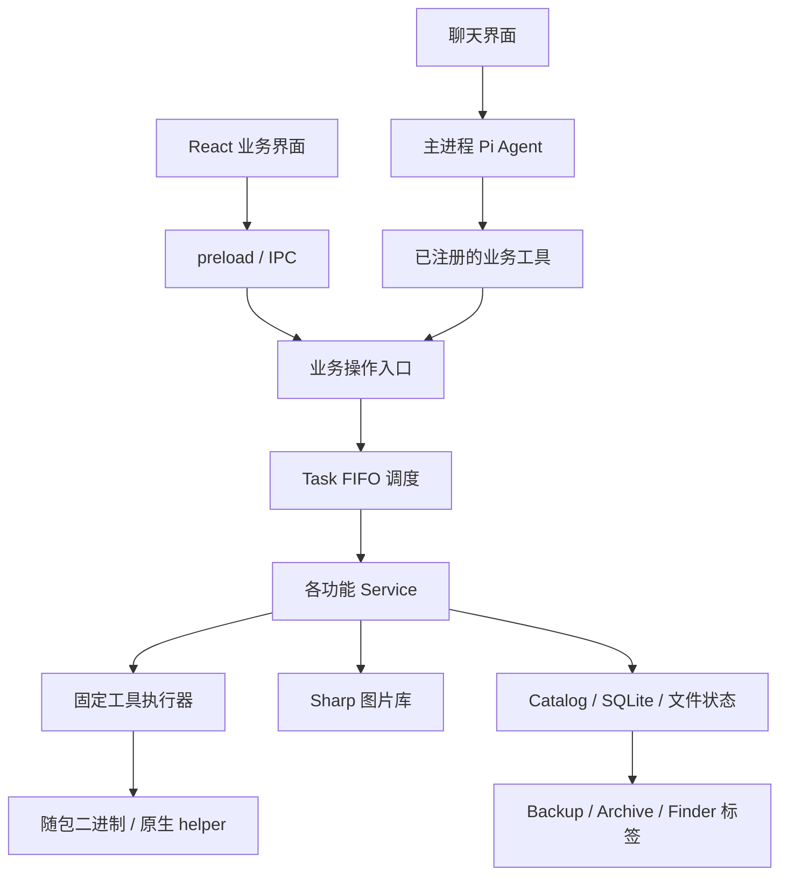
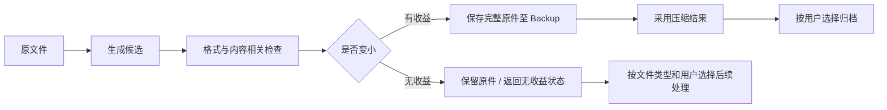

# Arkive 技术文档

Techathon 2026｜2026 年 10 月 18 日

Arkive 是面向存量文件的本地压缩与归档应用，优先支持 Apple 芯片 Mac。用户可以通过界面或产品 Agent 完成文件探测、压缩、备份、归档、标签管理及重复文件处理。本技术文档依据编写时的工作区源码，说明各模块如何协作、压缩参数如何选择，以及文件处理和质量评估的边界。

项目仓库：[ToTaleue/arkive-demo](https://github.com/ToTaleue/arkive-demo)，开发分支为 `feat/agent-and-service`。软件版本字段为 `1.0.0`；该字段不能单独区分各次开发与打包产物，最终提交时应同时记录源码版本及安装包标识。第三方版本、上游仓库和许可证见配套[第三方来源与依赖说明](第三方来源与依赖说明.md)。

## 一、技术栈与总体架构

| 层次 | 主要技术 | 职责 |
| --- | --- | --- |
| 桌面应用 | Electron | 窗口、主进程、原生文件交互和系统能力接入 |
| 用户界面 | React、TypeScript、assistant-ui | 压缩、归档、工具箱与聊天交互，展示进度和逐项结果 |
| 跨进程通信 | preload、类型化 IPC 契约 | 向界面提供明确的业务方法，连接主进程并传递状态 |
| Agent | Pi SDK 1.2.0 | 模型调用、对话上下文、工具循环、流式事件与内置 Skills |
| 业务执行 | TypeScript Service、Task FIFO | 组织处理流程，统一排队、防重、取消和结果判定 |
| 文件处理 | Sharp、FFmpeg、ab-av1、pngquant、qpdf 等 | 实际编码、探测、质量评分及结构检查 |
| 本地索引 | SQLite，使用 `node:sqlite` | 保存文件位置、标签、备份、归档及发布状态 |
| macOS 能力 | Finder 标签、APFS 原生 helper、Mole | 原生标签、克隆去重、磁盘分析和清理 |



界面与 Agent 复用业务入口。Service 决定档位、参数、校验、原件处理及多工具编排；`src/execution/process.ts` 负责 Arkive 发起的命令行调用，包括工具定位、参数传递、输出读取和进程取消。Sharp 是直接调用的 Node 库，不经命令行执行器。

执行器不承载压缩策略，也不作为通用 shell 接口暴露给界面或产品 Agent。直接复用的 Pi 只读工具保留 SDK 实现。

## 二、Pi Agent SDK 接入

Arkive 复用 Pi SDK 的模型接入、Agent 循环、消息上下文、工具调用和流式事件，将文件业务封装为明确的工具。模型负责理解用户意图、选择已注册工具及解释结果，实际文件处理由主进程业务代码执行。

- 探索能力复用 Pi 的 `read`、`grep`、`find`、`ls`；写入、压缩、归档、标签、去重及清理使用 Arkive 业务工具，不开放任意 shell。
- 产品只加载随应用提供的 Skills，包括演唱会录像、微信文件和 Lightroom 照片归档，不自动发现外部项目或全局 Skills、扩展和指令文件。
- 工具开始、更新和结束事件接入聊天界面，让用户区分执行过程、工具结果和 Agent 总结。工具调用结束不代表批量项目全部成功，业务结果仍须逐项判断。
- 当前聊天使用内存会话，仅在本次应用运行期间保留；SQLite 保存的是文件业务记录，不是另一套聊天历史。

Agent 的对话授权主要通过产品提示约束，部分操作还具有原生确认或业务检查；当前没有覆盖全部工具的统一授权状态机或文件系统沙箱。停止模型生成也不等于撤销已提交的文件操作，业务取消须传递到对应任务并等待收尾。

## 三、Task 调度与业务执行

压缩、归档、备份重试、批量标签、文件写操作、Mole 业务、重复扫描及 APFS 去重共用 FIFO 队列。串行调度减少多个重任务同时争用编码和磁盘资源，也让按钮与 Agent 的状态和执行规则保持一致。

一次压缩任务包含内部编码、校验、原件备份和用户请求的后续归档。Service 内部直接调用其他底层能力，不重复排队，避免父任务等待排在自身后面的子任务。

调度层提供以下行为：

1. 排队期间不启动编码，输出位置选择等原生交互在入队前完成。
2. 对相同输入或业务记录设置防重标识，拒绝正在排队或执行的重复请求；这些标识不等于阻止外部程序修改文件的通用文件锁。
3. 向界面与 Agent 返回真实结果，并区分等待、执行、取消收尾、成功和失败；视频百分比及剩余时间对应当前阶段。
4. 通过 `AbortSignal` 连接任务和工具进程。提交前取消会清理本次临时数据；进入备份或发布等提交阶段后，等待实际结果，不将已成功提交的操作误报成取消。
5. 应用退出时停止接收任务，等待已有任务及进程清理，再关闭业务资源和数据库。

Task 队列和运行结果只存在于当前进程，不提供重启后的任务历史或自动续跑。SQLite 中的文件发布状态及恢复记录用于业务一致性恢复，与恢复整条任务队列是两件事。只读检索、打开或定位、后台标签同步、启动恢复和管理员授权弹窗不占用业务队列。

## 四、压缩策略与质量评估

Arkive 使用已有编码器和格式工具完成底层压缩，自主实现输入探测、参数选择、质量评估、输出校验和原件处理。不同文件类型采用不同策略，不把一个固定参数用于所有素材。

### 4.1 视频：抽样评估后选择整片编码参数

视频默认使用 FFmpeg 的 HEVC VideoToolbox 硬件编码，兼容模式使用 H.264 VideoToolbox。ab-av1 用于抽样编码和 VMAF 评估；其名称不表示最终输出一定采用 AV1。

处理流程如下：

1. **探测输入。** 使用 ffprobe 读取分辨率、时长、帧数、位深、颜色信息、音轨和元数据，判断能否按当前策略处理。
2. **准备分析流。** 将选定视频流无损重封装为分析输入，减少封面及附加数据对选流的影响，不在此阶段重新编码画面。
3. **抽样试编码。** 当前配置抽取两段、每段一秒的样本，由 ab-av1 计算候选参数对应的抽样 VMAF。
4. **选择质量参数。** 默认 HEVC 路径使用 ab-av1 `crf-search`；H.264 兼容路径显式试编码 `q:v` 候选，通过二分搜索选择满足目标的参数。找不到满足目标的参数时报告失败，不自行降低目标。
5. **整片编码。** 使用选定参数编码完整视频，音轨直接复制；对不支持的输入返回原因，不擅自转码受限音轨或 HDR 内容。
6. **检查输出。** 检查编码、分辨率、时长、帧数、位深、音轨和需保留的元数据，再完整解码视频与音频，检查可解码性。通过后才发布候选结果并进入业务收尾。

| 档位 | 抽样 VMAF 目标 |
| --- | --- |
| 质量优先 | 98 |
| 均衡 | 95 |
| 体积优先 | 90 |

该策略旨在减少固定编码参数造成的过度压缩或无效编码，在体积与视觉质量之间寻找适合当前输入的参数。VMAF 是抽样感知质量指标，95 分不表示“保留 95% 画质”，两秒样本也不能证明整片所有镜头都没有可见损失。完整解码检查证明可解码性，不能替代主观观感、听感和音画同步验收。

体积收益以整片最终输出为准，不使用抽样预测值代替。视频没有变小时，产品入口采用原件作为后续结果，并单独记录未采用候选的路径和大小，避免将更大的候选作为有效压缩收益。

### 4.2 图片：按档位编码，以 SSIMULACRA2 描述结果

JPEG／WebP 主要通过 Sharp 编码，PNG 使用 pngquant。输入先做解码与元数据检查；输出检查尺寸、方向、透明度以及需要保留的元数据。透明图片转 JPEG 时必须明确背景色。

当前图片流程为：

1. 根据档位或用户给定参数生成首个候选。
2. 校验候选并比较实际体积；若已小于原件则停止继续降低质量，否则尝试更低的编码质量参数。
3. 选择可用结果后，使用 SSIMULACRA2 比较处理后的参考图与最终候选，返回评分、参考目标及是否达到目标。
4. 以不覆盖已有文件的方式发布结果；没有体积收益时返回 `no-savings`，不将其计为有效压缩。

| 档位 | JPEG／WebP 起始 quality | PNG 起始质量上限 | SSIMULACRA2 参考目标 |
| --- | --- | --- | --- |
| 质量优先 | 92 | 95 | 90 |
| 均衡 | 85 | 90 | 85 |
| 体积优先 | 80 | 85 | 80 |

编码器的 quality 参数与 SSIMULACRA2 分数含义不同。80 分是当前体积优先档的参考目标，不能据此保证每张图片肉眼无损。

**当前评分用于描述最终结果，不是发布门槛。** 低于参考分或评分不可用时，不自动提高编码质量重试，也不因此阻止已通过文件校验的候选发布。因此，本版本不宣称实现了“先激进压缩、低分后保守重压”的评分反馈循环。动画、多页、HDR 等受限输入按当前支持范围处理或拒绝，不推定支持全部图片特性。

### 4.3 PDF：区分无损优化与有损重写

| 档位 | 工具及策略 | 取舍 |
| --- | --- | --- |
| 无损 | qpdf：生成对象流、压缩流、重压缩 Flate 流 | 优化存储结构，不通过降低图片分辨率换体积 |
| 深度无损 | qpdf：上述策略加 Flate 等级 9 | 增加压缩计算，收益取决于输入 |
| 均衡 | qpdf 无损结构优化 | 保留文档内容，不进行有损重写 |
| 体积优先 | qpdf 无损结构优化（压缩等级 9） | 保留文档内容，体积收益取决于输入 |

处理前检查输入结构、页数和文档特征；结果写入临时目录，再检查结构、页数及表单、批注、附件、书签等特征标记。qpdf 的警告单独记录，接受警告退出码不等于跳过后续检查。

当前拒绝处理加密 PDF、数字签名和 PDF/A；有损档位还拒绝包含表单、批注或附件的文件。特征标记保持与结构检查不能证明每页视觉内容完全一致，PDF 也没有使用视频 VMAF 或图片评分作为整份文档质量保证。

通过校验后，以不覆盖方式发布候选。产品入口对无收益 PDF 采用原件，候选与实际采用结果分开记录。

### 4.4 Office：压缩包内媒体，保留其他文档部件

Office 压缩当前为**实验性功能**，支持普通 DOCX／PPTX。两类文件使用 OOXML 包结构，Arkive 主要处理其中体积较大的内嵌媒体：

- JPEG／PNG 保持原格式，复用图片 Service，变小且通过检查才回填；评分只作参考。
- 符合条件的包内 MP4 复用视频 Service，以 H.264／AAC 兼容路径处理；音轨复制，默认质量优先档使用抽样 VMAF 98 目标。
- 不支持、失败或无收益的媒体保留原字节。正文、关系 XML 和其他未处理部件保留原字节，不访问外链，不展开嵌套 OLE 对象。

回填后重新读取整份包，检查 CRC、XML 语法、内容类型、内部关系目标和条目哈希。只有媒体被接受且整份文档变小，才进入完整原件备份及原路径发布；无收益时保留原文档。

发布前再次核对原文件状态，防止覆盖处理期间被外部修改的文件。备份及发布计划持久化，启动时对未完成的发布事务进行恢复；不把“媒体编码成功”当作“整份文档替换成功”。

旧版 DOC／PPT、宏文档、签名文档及加密包不在当前支持范围。包级校验不等于 Word／PowerPoint 的排版、字体、动画或内嵌音视频均兼容，复杂文档仍需原生应用检查。

## 五、原件保护与失败处理

普通图片、视频和 PDF 的编码 Service 只生成候选副本，不直接移动原件。业务入口将编码、校验、备份及归档组织为一条生命周期：



失败或提交前取消不进入原件移动流程，已有输出不覆盖。备份、归档或标签操作失败时保留实际成功部分和错误信息，支持按记录处理后续步骤，不将整体业务误报为完成，也不强行重压已有结果。

Backup 与 Archive 相互独立。归档复制完成后核对 SHA-256，再发布正式归档路径；SQLite 保存各阶段状态。Office 原路径替换和 APFS 克隆去重采用各自的提交及恢复流程，不直接套用普通媒体的流程。

完整原件备份会继续占用磁盘。应用提供用户主动确认后的 Backup 清理，将符合条件的备份移入回收站；该行为不等于已经释放磁盘空间。压缩前后字节差额、归档副本大小和实际磁盘释放量分别说明，不混为一个收益指标。

## 六、APFS 克隆去重原理

媒体压缩改变文件的编码表示；APFS 克隆去重针对内容完全相同的多个文件，在保留各路径和内容的前提下，让它们共享底层存储块。

Arkive 使用 Czkawka 只读发现重复组，再通过项目自有的 C 原生 helper 执行 APFS 去重。helper 使用 clonefile 系列中的 `fclonefileat` 创建克隆，文件拥有独立 inode；后续修改采用写时复制，修改一份不直接改动另一份。当前要求源和副本位于同一 APFS 卷，不使用普通复制作为降级。

实际处理不是直接删除扫描结果：

1. 对授权的源文件和副本逐项核对，建立独立事务目录及恢复索引。
2. 从源文件描述符创建克隆快照，与副本逐字节比较，并复制、核验副本自己的权限、ACL、扩展属性和时间信息。
3. 再检查内容及文件状态，通过原子交换替换副本路径；交换后验证通过，才移除旧存储副本。
4. 中断后根据事务状态恢复；状态不明或文件已变化时保留恢复数据和路径，报告需核对的项目。

源文件不替换。克隆不是硬链接，成功后各路径可独立修改；inode 和部分文件系统时间信息会变化。硬链接、符号链接、跨卷及不支持的文件状态会拒绝处理。

去重授权包含校验后移除旧存储副本，此步骤不另外保留完整旧备份或放入回收站，否则旧数据可能仍占空间。结果分别报告成功、跳过、失败和未处理项；逻辑共享字节不等于实际释放空间，快照和既有共享块也会影响实际占用。

## 七、Mole 清理与工具箱

Arkive 复用随包 Mole 的分析、分类与清理能力，自身负责业务入口、任务调度、进程输出解析、界面反馈、取消以及选定项目的执行流程。

| 入口 | 处理方式 |
| --- | --- |
| Analyze | 使用 Mole JSON 结果展示目录占用、大文件和扫描完整性，支持目录钻取 |
| Purge／Installer／Uninstall 工具箱 | 先形成候选方案，用户审阅选择后，复查候选身份及路径，再通过 Arkive 移入回收站 |
| 独立 Clean 页面 | 预览执行 `clean --dry-run`；完整清理直接执行 Mole `clean`，保留其删除及默认清空回收站行为 |

完整 Clean 与工具箱的回收站流程有明确区别：前者可能永久删除，已发生的操作无法通过取消回滚，界面会提示这一行为。管理员授权使用 macOS 原生密码交互，不向 Agent 返回密码；授权成功本身不会自动开始扫描或清理。

工具箱使用预览与候选标识关联一次方案，实际执行前重新核验，不接受界面随意传入待删除路径。不完整扫描、超时和部分失败保留诊断信息；取消通过进程组收尾，不能将不完整扫描显示为全部完成。

## 八、归档存储、AI 标签与 SQLite

### 8.1 文件与业务记录分开保存

| 数据 | 默认位置或实现 | 用途 |
| --- | --- | --- |
| Archive | `~/Arkive Archive` | 保存最终归档文件，支持压缩结果及原样归档 |
| Backup | `~/Arkive Backup` | 保存完整原件，独立于归档副本 |
| SQLite | Electron `userData` 下的 `arkive.db` | 保存原路径、输出、备份、归档位置、标签及处理状态 |
| Finder 标签 | 文件的 macOS 原生标签 | 让用户在 Finder 和 Arkive 中使用归档标签 |

文件本体保存在普通目录，SQLite 不存放媒体文件内容。归档复制通过哈希检查后发布，不覆盖已有目标；已归档记录可以按 ID 查找、打开或定位。按需保留原位置软链接作为访问入口，该入口不是第二份内容副本。

### 8.2 AI 自动标签

自动标签读取原文件名、原路径、已有标签及程序提取的元数据，例如图片尺寸、视频时长、PDF 页数、Office 媒体数量。需要原文件信息时优先从完整备份读取；备份已清理时使用可用结果的元数据。

推荐器复用 Pi 的模型接入，执行一次无工具的独立请求，返回标签名称及依据。它不延续聊天会话，也不自行操作文件；业务层再合并用户指定标签并执行写入。用户可以关闭自动推荐，已有标签不因一次推荐被自动清空。

当前标签推荐没有把图片画面、音视频内容或文档全文交给模型，也不自动继承整段聊天上下文。由文件名和目录推断出的标签可能存在偏差，推荐成功或写入成功不等于语义判断正确。应用支持用户增删标签及再次检索，不将其宣传为已经具备完整内容识别能力。

### 8.3 Finder 标签与数据库同步

Finder 标签通过随包 JXA 脚本及 Foundation 的 `NSURLTagNamesKey` 读写。写入前读取当前标签并合并增删差量，写入后核对；失败保留状态供后续处理。应用在启动、归档目录事件、窗口激活和手动刷新时核对归档文件标签，包括外部删除标签的变化。

SQLite 保存归档索引及标签关系，支持文件名子串、多个标签 AND、源修改日期和归档日期筛选，以及分页查询。业务索引与 Finder 标签分别承担应用检索和系统可用性，不把后续归档标签修改同步到原件备份或其他输出副本。

当前没有全文、OCR 或语义向量检索，也没有外部移动／重命名后的完整自动追踪和数据库丢失后的自动重建。SQLite 持久化让业务记录可在重启后继续使用，不代表聊天或 Task 历史同样持久化。

## 九、运行复现、数据边界与核验入口

### 9.1 开发运行

当前完整本地工具链面向 macOS arm64，随包资源为 `darwin-arm64`。qpdf 构建的最低系统标记为 macOS 15；APFS helper 自身要求 macOS 13 及以上，完整应用应按较高的工具链要求准备环境。开发使用原生 arm64 Node.js 24 和 pnpm。

```sh
git clone --branch feat/agent-and-service https://github.com/ToTaleue/arkive-demo.git
cd arkive-demo
pnpm install --frozen-lockfile
pnpm run build
pnpm run dev
```

以上命令检出该分支的远端状态，不包含本地未提交修改。正式复现应固定最终提交版本，避免用移动分支代替已验收版本。

Agent 需要配置模型服务。开发时复制 `.env.example` 为 `.env.local`，填写服务商、接口根地址、准确模型 ID 和本人密钥后重启；运行环境变量也可提供配置。打包版支持读取外部指定位置的 `.env.local`，不会将开发密钥文件作为应用资源分发。凭据配置以主进程 `agent/config.ts` 为准。

打包命令为：

```sh
pnpm run build
pnpm exec electron-builder --mac --arm64
```

当前 `notarize` 为 `false`，部分分发配置仍为模板值，构建产物不等于已经完成签名、公证和终端分发验收。Windows 等平台的部分功能检查不能代替完整 Mac 工具链验收。

### 9.2 数据与执行边界

编码、哈希检查、SQLite、Backup 和 Archive 在本地执行。使用 Agent 或自动标签时，对话、工具返回以及提供给推荐器的文件名、路径和元数据可能发送给配置的模型服务；本地处理不等于所有请求离线。当前兼容模型接入声明为文本输入，不自动上传待压缩的完整媒体文件。

Arkive 发起的写操作检查系统关键路径及已有目标，用户目录不作为统一黑名单。检查和任务防重降低误操作及并发风险，但不宣称能隔离所有外部修改。真实清理、APFS 去重及备份清理各有不同的原件处理语义，按对应入口展示并执行用户授权。

### 9.3 核验方式

基础检查使用项目已有脚本：

```sh
pnpm run typecheck
pnpm run lint
pnpm run build
node scripts/check-tasks.mjs --ipc
node scripts/check-image-compression.mts
node scripts/check-video-compression.mjs
node scripts/check-pdf-compression.mjs
node scripts/check-office-compression.mjs
node scripts/check-catalog.mjs
node scripts/check-clone-deduplication.mjs
node scripts/check-agent.mts
```

检查涉及文件处理，应在 `~/Desktop/arkive-test` 的隔离样本上执行；原生工具检查需要相应 Mac 环境。固定响应模型检查与真实模型检查分别记录，不能互相替代。文档列出的是核验入口，本次编写未重新运行这些产品测试，不据此宣称全部场景已通过。

质量分数、可解码性、包结构完整、原生应用可打开以及主观体验属于不同证据。Office 维持实验性；全片观感与听感、全部复杂 Office 内容及分发安装须按对应范围另行验收，不从单项自动检查推导整体保证。

## 十、自主设计与源码对应

Arkive 的自主工作主要在业务流程与集成：让按钮和 Agent 共用任务入口，将参数选择、校验、原件保护和归档收尾组合为统一流程；建立文件状态与标签索引；实现 APFS 克隆替换事务及恢复；将 Mole 能力接入可观察、可取消的产品流程。底层编解码器、质量指标、文件格式工具及模型框架的权利和来源仍归对应上游。

| 技术内容 | 主要源码位置（相对仓库根目录） |
| --- | --- |
| Pi 会话、工具及资源范围 | `src/main/modules/agent/` |
| 任务调度 | `src/main/tasks/` |
| 视频选参及输出校验 | `src/main/modules/video-compression/service.ts` |
| 图片候选与评分 | `src/main/modules/image-compression/service.ts` |
| PDF 分档与特征检查 | `src/main/modules/pdf-compression/service.ts` |
| Office 媒体回填、校验及发布 | `src/main/modules/office-compression/` |
| 压缩备份收尾、归档及标签 | `src/main/modules/catalog/`、`src/main/modules/original-backup/` |
| APFS 去重与原生事务 | `src/main/modules/clone-deduplication/`、`native/apfs-dedupe.c` |
| Mole 业务与工具箱 | `src/main/modules/mole/` |
| 二进制调用及工具适配 | `src/execution/` |
| 跨进程契约与界面 | `src/shared/contracts/`、`src/preload/`、`src/renderer/src/` |

配套材料：[第三方来源与依赖说明](第三方来源与依赖说明.md)、[第三方依赖完整清单](第三方依赖完整清单.csv)、[随包工具来源清单](随包工具来源清单.json)。团队信息与原创版权声明见[Arkive 项目说明书](Arkive项目说明书.md)。
